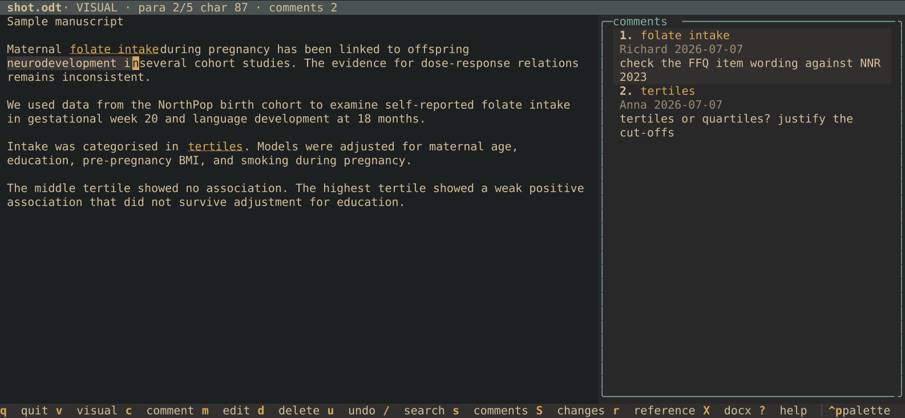

# sidenote

Review Word (docx), LibreOffice (ODT) and Markdown documents entirely from the keyboard. Add comments in a fast terminal UI.

Read a document in a TUI, select any span of text and attach a comment.

A Word document is commented in place. sidenote writes real Word comments
(`commentRangeStart`/`commentRangeEnd` plus `word/comments.xml`) into the
file it opened, rewrites only the two parts it has to, and copies every
other part of the docx through byte for byte. There is no conversion step
in either direction, so the file a co-author gets back is the file they
sent plus the comments.

A LibreOffice document is commented as native ODF inline annotations
(`office:annotation` + `office:annotation-end`). Export to docx goes
through headless LibreOffice.

Markdown works differently. The file is left exactly as it is and comments
go to a sidecar JSON file beside it, so the document stays a plain build
input that pandoc reads and git diffs line by line.

No mouse required. Built for reviewing manuscripts on a laptop when for example traveling.



## Install

```sh
pipx install git+https://github.com/Richard-Lundberg-Ulfsdotter/sidenote
```

Or from a clone

```sh
git clone https://github.com/Richard-Lundberg-Ulfsdotter/sidenote
cd sidenote
python -m venv .venv
.venv/bin/pip install -e .
```

Needs Python 3.10+. LibreOffice (`soffice`) on PATH is needed only to
export an ODT to docx. Reviewing a docx does not use it. Everything else
is pure Python (odfpy + Textual). Developed on Linux, should work
anywhere Textual runs.

## Usage

```sh
sidenote manuscript.odt              # open the TUI
sidenote manuscript.docx             # docx works too, see below
sidenote manuscript.odt --author "Richard Lundberg-Ulfsdotter"

sidenote manuscript.md               # markdown too, see below
sidenote manuscript.md --refcheck ../reference-check.md
sidenote manuscript.md --theme word  # black on white, as Word shows a page

sidenote list manuscript.odt         # print comments
sidenote check manuscript.md         # report orphaned comments
sidenote changes manuscript.odt      # print tracked changes
sidenote add manuscript.odt --para 2 --start 10 --end 24 --text "..."
sidenote add manuscript.odt --para 2 --start 10 --end-para 3 --end 5 --text "..."
sidenote export manuscript.odt       # write manuscript.docx next to it
sidenote sample demo.odt             # generate a test document
sidenote sample demo.docx            # the same text as a Word document
sidenote sample demo.md              # the same text as markdown
```

The author name defaults to `$SIDENOTE_AUTHOR`, then the login name.
`list` and `changes` read any of the three formats. `check` is about
sidecar anchors, so on a docx or an ODT it says the anchors are in the
document and exits zero.

### docx workflow

Opening a `.docx` reviews it in place. Comments a co-author already made
are read from `word/comments.xml` and shown with their author and date,
new comments are added beside them, and every comment saves straight back
into the file. Nothing is converted and there is no working copy.

Only `word/document.xml` and `word/comments.xml` are rewritten, and inside
document.xml only the runs that need a marker. Headers, footers, styles,
images, footnotes, fields, numbering, settings and Word's own comment
threading tables come through untouched. That matters when the document
goes back to someone working in Word, who otherwise receives a file that
lost half of itself on the way to a comment.

Anchoring is by character offset, so a comment can cover part of a word,
cross a formatting boundary or run from one paragraph into the next. A run
is split only where a marker has to go, and its run properties, images and
field codes are carried into both halves.

Every comment is already in the file by the time you see it on screen, so
there is nothing to export. `sidenote export --outdir` writes a copy
somewhere else if you want one, and `X` in the TUI is a plain re-save.

Tracked changes in a docx are read the same way as in an ODT, `w:ins` for
insertions and `w:del` for deletions, and shown read-only, inline and in
the `S` panel.

Footnotes and endnotes live in parts of their own and are not shown. They
are preserved untouched, and a footnote reference takes up no room in the
running text, so offsets and anchors are unaffected.

### Markdown workflow

Opening a `.md` (also `.markdown`, `.mdown`, `.mkd`, `.qmd`, `.rmd`) reviews
the file in place. Paragraphs are the blank-line separated blocks of the
source, shown as they are written, with fenced code blocks kept whole.
Comments go to `<name>.sidenote.json` next to the document. The markdown is
never written to, which is the point when it feeds a build or lives under
version control where comment churn would clutter prose diffs.

Comments are stored top to bottom and named for where they sit, so `cmt3`
in the sidecar is the third comment down and the one numbered 3 in the
sidebar. That makes it easy to point an editor, or an AI assistant reading
the JSON, at the comment you are actually looking at. The names are
positions rather than permanent identities, so adding a comment above an
existing one renumbers the ones below it.

Keep the two files together. The sidecar is named after the document, so
moving or renaming the markdown means moving the sidecar with it, and
committing both in one commit gives any past revision a matching set of
prose and comments.

Because the document can be edited outside sidenote, comments are re-found
on open rather than trusting stored offsets. Each end of a comment records
the surrounding wording, so inserting sections above, reflowing paragraphs
and rewriting neighbouring sentences all leave the comment where it belongs,
and a phrase replaced in place carries its comment across. Rewriting the
anchored words together with their surroundings is the case that cannot be
recovered. That comment is marked `orphaned` in the sidebar and kept at its
last known position rather than dropped, and sidenote says so on open.

`sidenote check` prints the same report and exits nonzero when anything is
orphaned, which makes it usable as a pre-commit hook.

```sh
sidenote check manuscript.md || echo "a comment lost its anchor"
```

There is no docx export for markdown. The comments are for reading in the
TUI and in `sidenote list`.

Markdown files open with the markup styled, headings in colour, emphasis
in italics, code and citation keys set apart, and the markers themselves
dimmed. `M` turns that off and back on. Nothing is hidden or reflowed
either way. The `**` stays where the author typed it, only its colour
changes, so a character offset means the same thing in both views, a
comment cannot tell which is on, and `char 34` in the status bar is
`char 34` in the file. `M` is a repaint, not a rewrap.

### Reloading

`R` re-reads the document without closing the review, whatever its format,
which is what you want when the file is also open in an editor in the next
window. The cursor stays where the new text allows, a visual selection is
dropped, and a running search is re-run against the new text rather than
kept as stale positions. A file that cannot be read, or that has become
empty, leaves the open review exactly as it was.

A reload only reads. For markdown that means the sidecar is not written,
so comments come back through the same re-anchoring as on open, sidenote
reports afterwards whether anything lost its anchor, and the stored
anchors stay as they were until the next comment change.

## Keys

| Key            | Action                                        |
| -------------- | --------------------------------------------- |
| `j` `k`        | move down/up one display line                 |
| `h` `l`        | move left/right one character                 |
| `w` `b` `e`    | word start forward/back, word end             |
| `f` `F` + char | jump to next/previous char in the paragraph   |
| `t` `T` + char | jump to just before/after it                  |
| `;` `,`        | repeat the last `f`/`t`, forward/backward     |
| `(` `)`        | previous/next sentence                        |
| `0` `$`        | start/end of display line                     |
| `{` `}`        | previous/next paragraph                       |
| `gg` `G`       | first/last paragraph                          |
| `ctrl+d/u`     | half page down/up                             |
| `ctrl+e/y`     | scroll view one line (cursor stays)           |
| `zz` `zt` `zb` | cursor line to center/top/bottom              |
| `v`            | toggle visual mode (character-level select)   |
| `is` `as`      | select the sentence, without/with its space   |
| `iw` `aw`      | select the word, without/with its space       |
| `ip` `ap`      | select the whole paragraph                    |
| `c`            | comment on selection, or point note at cursor |
| `m`            | edit comment (cursor or sidebar selection)    |
| `d`            | delete comment, confirm with `y`              |
| `u` `ctrl+r`   | undo / redo a comment change                  |
| `]` `[`        | jump to next/previous comment                 |
| `r`            | reference for the citation under the cursor   |
| `/`            | search (smartcase)                            |
| `n` `N`        | next/previous search match (wraps)            |
| `*` `#`        | search word under cursor forward/backward     |
| `s`            | open and focus comments sidebar / close it    |
| `S`            | open and focus tracked-changes panel / close  |
| `>` `<`        | jump to next/previous tracked change          |
| `D`            | show/hide deleted text lines                  |
| `M`            | markdown styling on/off (markdown files)      |
| `ctrl+p`       | command palette, themes among them            |
| `tab`          | switch focus between document and sidebar     |
| `ctrl+←/→`     | move the divider, resizing panel and document |
| `R`            | re-read the file after editing it elsewhere   |
| `X`            | export to docx (background, not for markdown) |
| `?`            | help (scrolls with `j`/`k`, escape closes)    |
| `escape`       | back to document / leave visual / clear search|
| `q`            | quit                                          |

`f` and `t` search the paragraph rather than the display line, because the
line breaks are only wrapping and move when the pane is resized. The
sentence rule is vim's, a `.`, `!` or `?` with any closing brackets or
quotes after it, then whitespace or the end of the paragraph. Text
objects work from normal mode as well as from visual mode, so `as`
selects the sentence around the cursor and `c` comments on it. They
always take the whole object, both ends of it, wherever in it the
cursor sits. That differs from vim, which extends an existing visual
selection forward only, but selecting from the cursor to the end of
something is what `vf.` and `v)` already do. `ip` and `ap` both take
the whole paragraph, there being no blank lines to include.

Everything is keyboard-driven, no mouse needed. When the sidebar is
focused, `j`/`k`/`g`/`G` move the selection, enter jumps to the
comment's anchor in the document, `m`/`d` act on the selected comment,
and `/` filters the list by author name or comment text
(case-insensitive substring, shown in the sidebar title as
`comments · anna (2/3)`). `n`/`N` cycle through the filtered comments
with wraparound, and `*`/`#` filter to the selected comment's author
and step to that author's next/previous comment. Escape clears the
filter first, then returns to the document. Closing the sidebar also
clears the filter.

With the sidebar open the selection follows the cursor. Moving onto
commented text in the document highlights that comment in the panel and
scrolls it into view, so the note is readable without leaving the
document. Off any comment the last selection stands, and a comment
hidden by an active filter is left alone.

`ctrl+←` and `ctrl+→` move the divider between the document and the open
panel in steps of four columns, and the text rewraps to the new width.
The panel stops at 20 columns and never leaves the document less than 30.
Both panels share the width, so the split stays where you put it when
switching between comments and changes.

Search matches highlight with the current match in a colour of its own,
and the status bar shows the match position (`/folate 2/5`). `*`/`#` use
whole-word matching, as in vim.

### Reference check

A manuscript written for pandoc carries its citations as keys,
`[@blomhoffNordicNutritionRecommendations2023]`. Put a `reference-check.md`
beside the document and `r` opens an overlay with what that file says about
the citation under the cursor, so the claim can be checked against its
source without leaving the review.

The file is an ordinary Markdown pipe table, one row per citation, with
columns for the statement, the reference key, the supporting quote and a
status. Columns are matched by name rather than position, so extra columns
and different section headings are fine.

```markdown
## 1. Introduction

| Statement                       | Reference                        | Supporting quote                      | Status |
|:--------------------------------|:---------------------------------|:--------------------------------------|:-------|
| Folate reduces neural tube risk | bjorke-monsenFolateScoping2023   | "prevents most cases of spina bifida" | OK     |
| Energy cutoffs are standard     | liMaternalDiet2024; yangDiet2022 | "less than 500 kcal/day"              | OK     |
```

A row naming two keys is found under both.

The overlay shows every row citing that key, so a source used in two places
is checked in one view. Inside a grouped citation like `[@a2020; @b2021]`
the cursor anywhere in the brackets reaches all the keys and `n`/`N` step
between them. `o` opens the full-text PDF, `j`/`k` scroll, escape closes.
The file is re-read on every `r`, so a row added in another window shows up
without reopening the document.

sidenote looks for `reference-check.md` beside the document and up to two
directories above it, `--refcheck` names one explicitly, and
`$SIDENOTE_REFCHECK` sets it for good.

The full texts are found by citation key, `<key>.pdf`. The directory comes
from the check file itself when it documents one, as in

```markdown
- Full texts: `/home/richard/research/references/<key>.pdf`
```

otherwise from `$SIDENOTE_REFERENCES`, otherwise from
`~/research/references`. `$SIDENOTE_PDF_VIEWER` replaces `xdg-open` for
anyone who wants a particular reader.

None of this is required. Without a check file the `r` key just says so,
and everything else works as before.

### Tracked changes

Documents with Word tracked changes show them read-only. Inserted text
renders green inline. Deleted text appears as red struck-through lines
woven in at the spot it was removed (`D` hides and shows them), and a
red underline marks the deletion point in the running text. The
deleted lines are display-only, the cursor skips them and comments
cannot anchor there. The status bar names the change's author when the
cursor is on one, including the deleted text for deletions. `S` opens
a panel listing every insertion and deletion with author, date, and
the affected text, enter jumps to its place in the document, and
`>`/`<` step through changes without the panel. The `changes`
subcommand prints the same list in the terminal. Format-only changes
are not shown, and accepting or rejecting changes stays in LibreOffice
or Word.

Comments save immediately when added, edited, or deleted, to the docx or
ODT itself or to the markdown sidecar.
The comment dialog quotes the full selected text (across paragraphs,
capped at 600 characters) above a multi-line editor, enter inserts a
newline, `ctrl+s` saves, escape cancels.

### Theme

The interface uses `gruvbox-material` by default. Any other theme can be
picked with `--theme` or the `TEXTUAL_THEME` environment variable, and
`ctrl+p` opens the command palette, which switches theme in a running
session.

```sh
sidenote paper.md --theme word
TEXTUAL_THEME=nord sidenote paper.odt
```

`gruvbox-material` is the palette of the nvim colorscheme of that name,
at `background = hard` and `foreground = material`, so a manuscript
looks the same here as in the editor it was written in. Search fills in
the colorscheme's `Search` green and the current hit its `IncSearch`
red, the selection is `Visual` grey, headings are orange as `Title` is,
and the cursor is a yellow block.

`word` is sidenote's own, a page as Word shows one. Black on white,
headings in Word's title blue, commented text on a pale yellow fill,
tracked insertions underlined in blue and deletions struck in red.

A theme without a set of its own gets one chosen by its background, so
every other light theme is still readable and every other dark one
keeps the original marks, an underlined yellow comment being invisible
on white paper.

The font belongs to the terminal, not to the program, so Aptos has to
come from the terminal. Aptos Mono is the monospace member of the family
and the one to point a terminal at. Alacritty can restyle the window you
are already in, over its IPC socket, which also works from a keybinding.

```sh
alacritty msg config 'font.normal.family="Aptos Mono"'   # this window
alacritty msg config -r                                  # and back
```

Or start a window with it, which is the only option in kitty.

```sh
alacritty -o 'font.normal.family="Aptos Mono"' -e sidenote paper.md --theme word
kitty -o font_family="Aptos Mono" sidenote paper.md --theme word
```

## Architecture

```
sidenote/
  engine.py   ODT model. Load, plain-text paragraphs, comment anchoring
              at (paragraph, character offset), edit/delete, save,
              docx export via headless LibreOffice.
              `open_review()` picks the engine that fits the file.
  docx.py     Word model, same interface. Walks document.xml for
              paragraphs, runs and markers, splices comment markers into
              the bytes, splitting a run only where one has to go, and
              rewrites the zip with every other part copied through.
  markdown.py Markdown model, same interface. Blocks as paragraphs,
              comments in a sidecar JSON file, anchors relocated by
              their surrounding text when the document has moved.
              `markup_spans()` says where the markup sits, for styling
              the source in place.
  tui.py      Textual frontend. Vim navigation, text objects, visual
              selection, search, comment modal, sidebar, help. Keeps a
              display-line map back to engine positions. The document
              pane renders only visible lines, so navigation stays
              fast on long documents.
  theme.py    The `word` theme, and the pane's own styles for comments,
              search, changes and markdown, one set per background.
  refcheck.py Reads a manuscript's reference-check.md, indexes its
              table rows by citation key, and locates the full-text
              PDFs. Optional, absent for most documents.
  cli.py      Entry point. TUI plus list/check/add/changes/export/sample
              subcommands, and the sample document in all three formats.
tests/
  test_engine.py   ODT round-trips, tracked-change parsing, and a
                   soffice export check that the comment survives as a
                   Word comment.
  test_docx.py     Word round-trips, run splitting around images,
                   fields, hyperlinks and table cells, and the check
                   that only the two parts change.
  test_markdown.py Sidecar round-trips and the re-anchoring cases,
                   including that the markdown is never modified.
  test_refcheck.py Table parsing and citation detection under the
                   cursor, including grouped citations.
  test_tui.py      The frontend under Textual's pilot. Motions, text
                   objects, search, sidebar, undo, and that an engine
                   error is reported rather than fatal.
```

The engines are deliberately frontend-agnostic and share one interface, so
the TUI and CLI never branch on file format. A future Neovim plugin can call
`open_review()` (or the CLI) without touching the TUI.

Key invariant. Comment markers contribute zero width to the extracted
plain text, so adding a comment never shifts the character offsets of the
surrounding text. Insertion splits the document at the requested offset,
text nodes and multi-space `text:s` elements in ODT, runs and their `w:t`
children in docx.

## Known limits

- Table cells are separate paragraphs in both formats. Footnotes and text
  frames are where the two diverge. An ODT flattens both into the running
  text, a footnote landing mid-sentence with its citation number. A docx
  keeps footnotes and endnotes in parts of their own and text boxes inside
  a drawing, so neither is shown and neither can be commented on, and the
  same goes for embedded objects and equations. All of it is preserved
  untouched either way.
- Deleted text is shown on separate display lines, not woven into the
  running sentence. Comments anchored to deleted text are not shown.
- Word "moved" tracked changes are not marked as moves. The text shows at
  its new place as ordinary text and the copy at the old place is hidden,
  which is the document as accepting the move would leave it.
- No comment threads or replies (single-level comments, as in ODF).
- No editing of the document text, this is a reviewer, not an editor.
- Deleting a docx comment removes its markers but leaves the run it split
  in two pieces. The text, the formatting and what Word displays are
  identical, and Word rejoins the runs on its own next save.
- A comment sidenote adds to a docx carries no `w14:paraId`, which is the
  optional Word extension that records threading and resolved state. Word
  reads such a comment as an ordinary unresolved one. Replying to it or
  resolving it in Word works and adds the paraId there.
- The docx engine is verified against Word for the web, LibreOffice and
  its own test suite. Desktop Word has not been tried.
- Exporting an ODT to docx goes through LibreOffice, so complex Word
  layout may shift on that path. Comments and text survive. Reviewing a
  docx does not use that path at all.
- Markdown is styled, not rendered. The markers are dimmed rather than
  hidden, because offsets have to keep matching the file you edit, which
  is what anchoring needs.
- Markdown comments cannot be exported to docx, and a markdown comment
  whose anchor text and surrounding wording are both rewritten is marked
  orphaned rather than relocated.
- The reference overlay reads a hand-maintained check file, not the
  bibliography. It reports what that file says, and says nothing about
  whether the file is up to date with the manuscript.

## Development

```sh
.venv/bin/python -m pytest tests/ -q
.venv/bin/python tools/make_screenshot.py   # redraw docs/screenshot.svg
```

The suite covers all three engines, unzipping the docx it produces to
check the comment markers pair up and that no other part moved, and
drives the TUI headlessly through Textual's pilot. The one test needing
LibreOffice is the ODT export, skipped when `soffice` is missing. CI runs
it on Python 3.10 and 3.14.

## License

GPL-3.0-or-later, see [LICENSE](LICENSE). If you distribute a modified
version, you must make its source available under the same terms.
